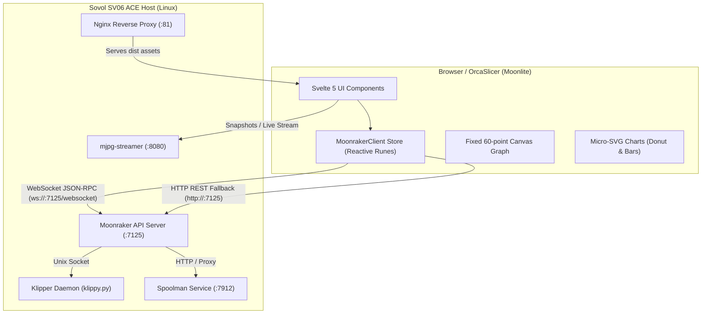

# Moonlite Architecture & Design Philosophy

## 1. Problem Statement: The WebKit Memory Leak

3D printer web interfaces such as **Mainsail** and **Fluidd** are rich, full-featured applications built with frameworks like Vue.js. However, they rely heavily on:
* **Complex Reactive Component Trees**: Hundreds of deep virtual DOM updates per second.
* **Heavyweight Third-Party Charting Libraries**: Chart.js, ApexCharts, or D3.js which create canvas/SVG objects and retain retained-mode JS heap arrays indefinitely.
* **Continuous MJPEG Video Rendering**: Browsers (especially WebKit in macOS, iOS, and OrcaSlicer's embedded browser window) accumulate decoded JPEG textures in memory without aggressive garbage collection.

### Symptoms observed on the author's setup (OrcaSlicer on macOS):
* Mainsail running inside OrcaSlicer's "Device" tab grew from **~150 MB** to **several GB of RAM** over a 2–3 hour print job.
* macOS starts paging to swap, resulting in beachballs, sluggish slicer UI, and system freezing.
* High idle CPU usage (5–15% CPU just sitting on an idle tab).

---

## 2. The Moonlite Solution

**Moonlite** was engineered specifically to solve this problem while delivering an experience visually on par with Mainsail:

* **Svelte 5 Runes (`$state`, `$derived`, `$effect`)**:
  Compiles to minimal, direct DOM updates. Zero virtual DOM overhead.
* **Bounded HTML5 Canvas & SVG**:
  - Temperature history is sampled every 2 seconds into a bounded buffer of 60 points (≈ 2 minutes).
  - The graph is a single native `<canvas>` repainted when a sample arrives (HiDPI-aware).
  - Spoolman graphics, status indicators, and History charts are small inline SVGs.
  - The console log is capped at 100 lines.
* **No background polling**: data arrives via Moonraker push notifications; lists are reloaded on connect, on state changes and on `notify_filelist_changed`. The only timers are the 2 s temperature sampler, the camera snapshot refresh (only while the camera is on), and a 5 s Klippy readiness check that runs only while Klippy is not ready.
* **On-Demand Camera**:
  - The camera is **off** by default.
  - When on: **Snapshot** mode refreshes one JPEG every 2 seconds; **Live stream** shows the MJPEG stream.
* **Light Bundle**:
  - The JS bundle is **~50 kB gzipped**.

---

## 3. High-Level System Architecture

---

## 4. Key Subsystems

### 4.1. Moonraker Reactive Client (`src/lib/moonraker.svelte.ts`)
* Singleton `MoonrakerClient` using Svelte 5 `$state` runes.
* Automatic WebSocket reconnect with exponential backoff (1 s → 30 s). Each socket's handlers ignore events once it has been replaced, so changing the host never leaves a second live socket behind.
* Address: production builds use the page's own origin (nginx proxies Moonraker); the dev server connects to `VITE_PRINTER_HOST:7125`. An address typed in the header is persisted in `localStorage`.
* Waits for Klippy to be `ready` (and re-initializes on `notify_klippy_ready`, e.g. after `FIRMWARE_RESTART`).
* Discovers objects via `printer.objects.list` and subscribes to the ones present:
  `print_stats`, `display_status`, `virtual_sdcard`, `extruder`, `heater_bed`, `toolhead`, `fan`, `gcode_move`, all `temperature_sensor`/`temperature_host` objects, and optional peripherals (a light `output_pin`, the first `heater_fan`, `controller_fan` and filament sensor).
* Status updates are applied as deltas (Moonraker only sends changed fields).

### 4.2. Dual-Mode Status Card (`src/lib/components/StatusCard.svelte`)
* **Standby Mode**: When no print is running, displays the **5 most recent G-code files** with full slicer metadata, filament consumption, and instant 1-click start.
* **Active Print Mode**: Displays the enlarged 3D render thumbnail, circular progress, layer telemetry, feedrate/flow rates, and compact pause/resume/cancel controls.
* **Finished Print Actions**: Displays the 🧹 **Clear** button (executes `SDCARD_RESET_FILE`) and 🖨️ **Reprint** button.

### 4.3. Spoolman Vector Engine (`src/lib/components/SpoolmanCard.svelte`)
* Probes Moonraker's Spoolman component via `server.spoolman.get_spool_id` and `/server/spoolman/proxy`.
* Renders an authentic 3-spoke filament spool in pure SVG with 3 curved windows showcasing the real filament color hex.
* Real-time calculation of remaining filament weight (g), total weight, remaining length (m), and percentage.

### 4.4. History Analytics (`src/lib/components/HistoryTab.svelte`)
* Fetches aggregated totals from Moonraker's `/server/history/totals`.
* Micro-SVG **Donut Chart** representing print completion rate.
* Dynamic **Daily Activity Bar Chart** comparing filament consumption vs print duration over recent days.
* Job table with server-side pagination; search and status filters cover the last 200 jobs.

---

## 5. Performance Notes

The JS bundle size is measured by `npm run build` (~50 kB gzipped). The figures below are
approximate observations from the author's setup (OrcaSlicer on macOS, Sovol SV06 ACE),
not a reproducible benchmark — measure on your own machine before relying on them.

| Metric | Mainsail / Fluidd | Moonlite |
| :--- | :--- | :--- |
| **JS bundle (gzip)** | ~2.5 MB | **~50 kB** |
| **RAM after a 3-hour print (WebKit)** | several GB | tens of MB |
